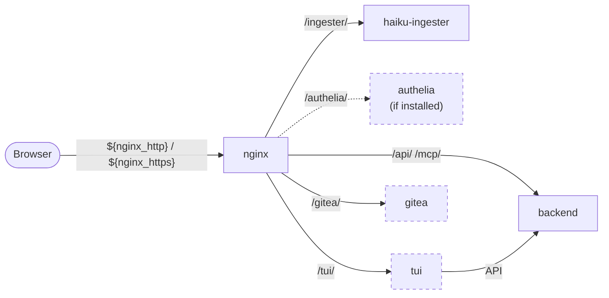
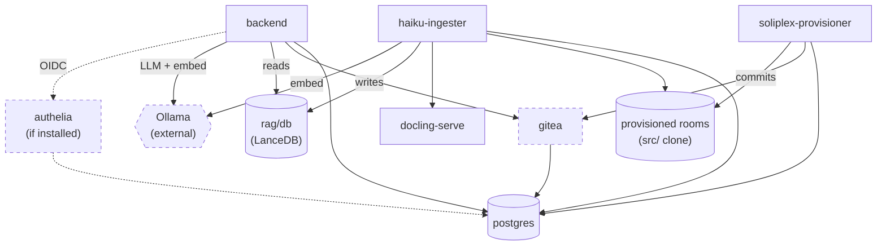

# Service graph

<!-- site-only -->
!!! note "About this page"
    This documents a stack **generated from `soliplex-template`**. A generated
    project ships its own copy of this page without this note.
<!-- endsite-only -->

The stack is defined in `docker-compose.yml`. Browsers reach every service
through nginx, which routes each path prefix to the service behind it.
In the diagrams, dashed outlines mark what is not always a stack service:
Authelia exists only once installed, and Ollama runs outside the stack.

<!-- site-only -->
The TUI and Gitea are dashed too: a project includes each only when
generated with it.
<!-- endsite-only -->



Behind nginx, the services share Postgres (each with its own database) and
two stores on disk: the backend reads the RAG vector store the ingester
writes, and the ingester reads the room fragments the provisioner commits.
Both the backend and the ingester reach Ollama at `OLLAMA_BASE_URL`.



## nginx

- Serves the Flutter web frontend.

- Reverse-proxies `/api/` and `/mcp/` to `backend:8000`.

- Reverse-proxies `/ingester/` to `haiku-ingester:8765`
  (see [Ingester control plane](../operations/ingester.md)).

- An installed Authelia provider is reverse-proxied at `/authelia/`
  (see [Sign-in: choosing and running an identity
  provider](../authentication.md)).

- The web client is copied in `nginx/Dockerfile` from the published
  `ghcr.io/soliplex/frontend-web` image, whose tag picks the release

- Its assets sit under a `v<release-tag>/` directory, which `nginx/nginx.conf`
  caches for a year

- `index.html` is never cached, so a new release reaches browsers
  on their next load.

- Terminates TLS on host port ${nginx_https} with a self-signed cert.

- Both servers include every `nginx/conf.d/*.conf` fragment, which skill
  scripts add and remove (see `nginx/conf.d/README.md`). nginx reads them
  only at start: `docker compose restart nginx` after a change.

## backend

Runs `soliplex-cli serve /environment`, from an image built on the published
soliplex release image (see [Backend image & dependencies](backend.md)).
Authentication follows `backend/environment/oidc/config.yaml`: with no
OIDC provider there, the backend runs without authentication (see
[Sign-in and admins](../installation.md#sign-in-and-admins)). The `--reload=config`
flag means edits under `backend/environment/` take effect without a rebuild,
and one `--reload-dirs` flag per project on its `PYTHONPATH` (this project's
own package, plus any added with `src_projects.py`) restarts it when their
code changes.

## soliplex-dev

A one-shot task runner, not a long-running service: `profiles: ["devmode"]`
keeps it out of `docker compose up`. It exists for commands that need the
stack's config, secrets and databases *and* write access to the project
directories under `src/`.

It is built on the backend's own image (`soliplex-dev/Dockerfile`, with
compose passing the backend's image in as `service:backend`), plus every
`src/` project's `dev` dependency group, so a project's tests run here against
the backend's versions (see
[Custom Python package](../custom-package.md#running-its-tests-there)). It
mirrors the backend's secrets, mounts and environment — the same `/app/src`
paths, and the very same `PYTHONPATH` (a YAML alias, so the two cannot
drift). So an audit run here sees exactly what the backend sees:

```bash
docker compose run --rm soliplex-dev \
    /app/.venv/bin/soliplex-cli audit /environment
```

The one difference is that `src/` is mounted **read-write** (the backend
mounts the same tree read-only). Pass `-w /app/src/<project>` for anything
that must run from a project's own root — `alembic` writes into its
`versions/` directory and prepends `.` to `sys.path`:

```bash
docker compose run --rm -w /app/src/soliplex soliplex-dev \
    /app/.venv/bin/alembic -x soliplex.installation_path=/environment \
    revision --autogenerate -m "add a column"
```

Any project directory under `src/` works, not just a `soliplex` checkout.

## soliplex-provisioner

The room provisioner's HTTP service (see
[Room provisioning](../operations/room-provisioning/service.md)):
it creates rooms on a requester's behalf, for callers holding the stack's
`url_safe_token_secret`. It runs with `docker compose up`, listening on the
compose network only, at `http://soliplex-provisioner:8090`.

It shares `soliplex-dev`'s image, secrets, environment and mounts (YAML
aliases in `docker-compose.yml`), including its read-write `src/`, where
the provisioner commits each room and its database fragment to the
provisioned-rooms clone. The ingester mounts that clone read-only, and its
config includes the fragments.

## stack-init

A one-shot setup run, held out of `docker compose up` by
`profiles: ["init"]`. Run it before the stack first comes up, and again after
adding a part of the stack that brings its own setup step:

```bash
docker compose run --rm --quiet-build stack-init
```

It shares `soliplex-dev`'s image, secrets and environment. `stack-init/run.sh`
brings the Soliplex databases to their current schema
(`soliplex-cli database upgrade`), then runs every step in
`stack-init/init.d/`, in name order. Each step is safe to re-run.

## authelia

The in-stack OIDC provider, installed after generation with
`scripts/install_authelia.py` and absent from stacks that never installed it
(see [Sign-in: choosing and running an identity
provider](../authentication.md)). The pinned Authelia image serves its own
TLS on the HTTPS port at `/authelia/`, with a network alias so the backend
reaches the issuer URL directly; nginx reverse-proxies the same path for
browsers. Its state lives in the `soliplex_authelia` Postgres database; its
configuration is bind-mounted from `authelia/` (`configuration.yml`, the
gitignored `users.yml` and `notification.txt`, and the committed
`identifiers.yml`). The service and its secrets live in a separate
fragment, `compose.authelia.yaml`, pulled in by a top-level `include:` in
`docker-compose.yml`.

## haiku-ingester

The **writer** for the LanceDB at `rag/db/`.

Runs `haiku-ingester serve --root-path /ingester` with a Postgres-backed
job queue (its own `soliplex_ingester` database), an async worker pool,
retries + a dead-letter queue, and an HTTP control plane.

Secrets handling:

- The service entrypoint exports `INGESTER_DB_PASSWORD` and `INGESTER_TOKEN`
  from Docker secrets files;

- The `haiku-rag` config machinery interpolates them into `haiku.rag.yaml`

There is a **single-writer constraint**: only one ingester per LanceDB.
Reads are safe while the stack is up; writing a store the ingester
owns needs `docker compose stop haiku-ingester` first.

The backend reads the same store through a bind mount. See
[RAG pipeline](../operations/rag.md) and
[Ingester control plane](../operations/ingester.md).

## haiku-rag

A **one-shot runner** for the `haiku-rag` CLI, held out of
`docker compose up` by `profiles: ["tools"]` (`docker compose run` enables the
profile itself). It shares the ingester's image, mounts, environment and
queue-password secret, and passes whatever follows the service name straight to
the CLI:

```bash
docker compose run --rm haiku-rag info --db /data/haiku.rag.lancedb
```

Uses the same secrets interpolation as `haiku-ingester`.

## docling-serve

A stateless document converter. Runs the upstream `-cpu` image
directly;  its variant/version are chosen at generation and baked
into `docker-compose.yml` — re-point by editing that line and
committing (see the stack's `docling-serve/README.md` for the
variants, the tagging policy, and a local-build recipe).
<!-- if:tui -->

## tui

Soliplex's [Textual](https://textual.textualize.io/) terminal client, served
as a web app over textual-serve; nginx proxies it at `/tui/`, so open
<https://${server_name}:${nginx_https}/tui/>. The same client is bundled in
the backend image — to run it from the command line, see
[Using the TUI](../installation.md#using-the-tui).
<!-- endif -->

## postgres

Creates the stack's databases on first boot via `postgres/config/init.sh`:

- `${agui_db}` (thread persistence)
- `${authz_db}` (authorization policy)
- `soliplex_ingester` (the haiku-ingester job queue)
  <!-- if:gitea -->
- `soliplex_gitea` (Gitea's backing store)
  <!-- endif -->

Each gets a dedicated low-privilege role whose password is a Docker secret.

Init runs **only on an empty data volume**; to re-run it,
`docker compose down -v` first.

<!-- if:gitea -->

## gitea

A local [Gitea](https://about.gitea.com/) instance (rootless image), backed by
the `soliplex_gitea` Postgres database. nginx reverse-proxies it under `/gitea/`
on the HTTPS port — open <https://${server_name}:${nginx_https}/gitea/>. Its
built-in SSH and HTTP are unpublished by default; set `gitea_ssh_port`
(git-over-SSH clones from the host) or `gitea_http_port` (direct web/HTTP) to
publish. State lives in the `gitea_data` / `gitea_config` named volumes.
Provision it after first boot with `scripts/init_gitea.py` — see
[Provision Gitea](../installation.md#provision-gitea).

Two of its settings serve the concierge's tracking issues:

- it accepts YAML attachments, beside Gitea's stock types: each requester's
  profile is attached as `user-profile.yaml`
- it builds links from its public URL, whichever host a request came
  through: the backend and the room provisioner call it at
  `http://gitea:3000`, and the issue links they show users point at
  `/gitea/`

<!-- endif -->
