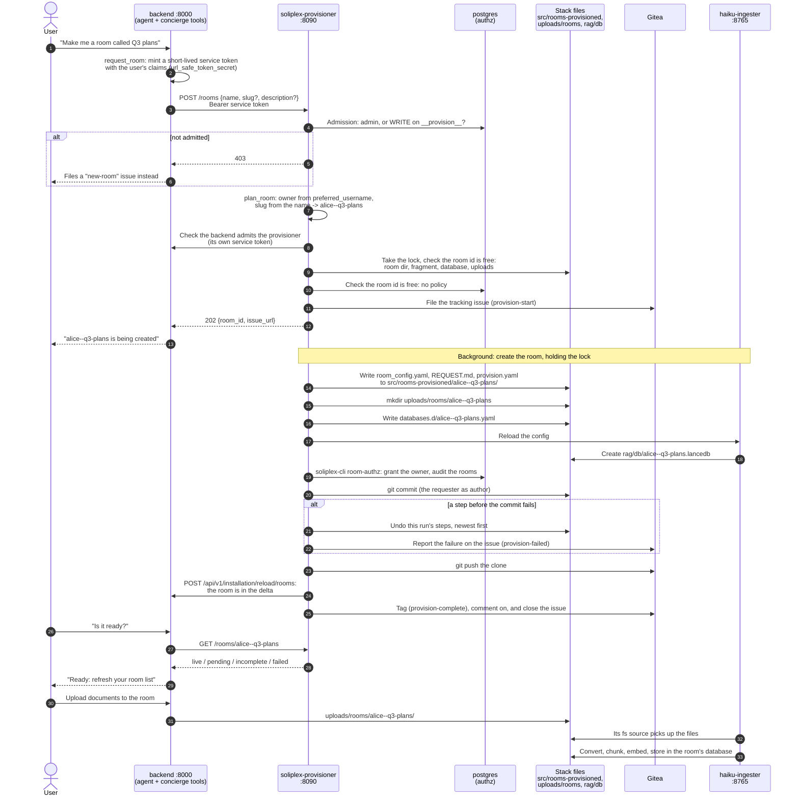

# Room provisioning

<!-- site-only -->
!!! note "About this page"
    This documents a stack **generated from `soliplex-template`**. A generated
    project ships its own copy of this page without this note.
<!-- endsite-only -->

The room provisioner creates a private RAG room for a requester in one
step: the room's config, its own database, ingestion from the room's
uploads, and access for its owner alone: the requester, unless an admin
names another (see [Rooms for someone else](service.md#rooms-for-someone-else)).

A room is requested in one of two ways:

- a user asks the concierge's about room, whose `request_room` tool calls
  [the provisioner service](service.md) on their behalf
- an operator runs the provisioner
  [from the command line](command-line.md), naming the requester

## A request, end to end

A user asking the concierge's about room for a room, with the
[provisioner service](service.md)'s default settings:

## Where to go next

- [The provisioner service](service.md): its endpoints, refusals and
  admission, and rooms for someone else
- [What it does](how-it-works.md): each step, what it refuses before
  changing anything, and its limits
- [From the command line](command-line.md): provisioning a room by hand
- [Reconciling the stack with the clone](reconcile.md): replaying the
  clone's records after the stack drifts from them
- [Configuration](configuration.md): settings, OIDC, git policy and the
  provisioned rooms' agent
